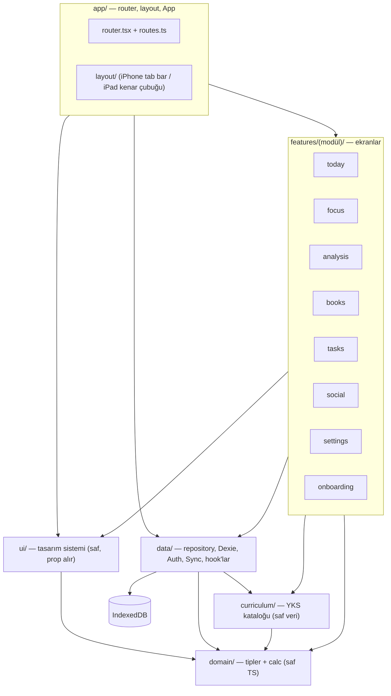
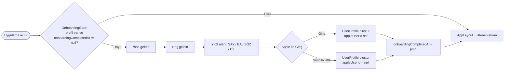

# Fokus Mimarisi

Bu belge web prototipinin (`web/`) katmanlarını, veri akışını ve native uygulamaya (SwiftUI + SwiftData + CloudKit) geçiş planını anlatır. Kurallar ve modül sahipliği için önce [../CLAUDE.md](../CLAUDE.md) okunmalıdır.

Sözleşme dosyaları (değiştirirken bu belgeyi de güncelle):

| Sözleşme              | Dosya                                              |
| --------------------- | -------------------------------------------------- |
| Varlık tipleri        | `web/src/domain/types.ts`                          |
| Saf hesaplar          | `web/src/domain/calc/{focus,tests,books,tasks}.ts` |
| Repository arayüzleri | `web/src/data/repository.ts`                       |
| Kimlik doğrulama      | `web/src/data/auth/AuthService.ts`                 |
| Senkron               | `web/src/data/sync/SyncService.ts`                 |
| Servis kümesi         | `web/src/data/services.ts` (`AppServices`)         |
| Dexie şeması          | `web/src/data/dexie/db.ts`                         |
| Rotalar               | `web/src/app/routes.ts`, `web/src/app/router.tsx`  |
| Müfredat              | `web/src/curriculum/types.ts`                      |

## 1. Katmanlar



Oklar izin verilen import yönüdür; `web/eslint.config.js` bunları zorlar. Feature'lar birbirini import etmez; `app/` feature'lardan yalnızca `router.tsx` içinde ekran bileşenlerini alır.

## 2. Veri akışı

```mermaid
sequenceDiagram
  participant S as Ekran (features/*)
  participant H as Hook (useLiveData / useCurrentProfile)
  participant R as Repository (arayüz)
  participant D as Dexie implementasyonu (data/dexie)
  participant DB as IndexedDB
  participant Y as SyncService (mock)

  S->>H: okuma (sorgu fonksiyonu)
  H->>R: findAll / findBy...
  R->>D: Dexie sorgusu (liveQuery)
  D->>DB: oku
  DB-->>S: sonuç; değişince otomatik yeniden render
  S->>R: create / update / delete (useServices().repositories)
  R->>D: yaz (id, createdAt, updatedAt, deletedAt doldurulur)
  D->>DB: put
  D->>Y: recordLocalChange({ entity, id, op, at })
```

- **Okuma:** Ekranlar `@/data` hook'ları üzerinden reaktif okur (Dexie `liveQuery`; `dexie-react-hooks` yalnızca `data/` içinde).
- **Yazma:** Ekranlar `useServices().repositories.<varlık>` çağırır. Repository yeni nesne döndürür, girdiyi mutasyona uğratmaz.
- **Senkron kaydı:** Her yazmadan sonra repository `SyncService.recordLocalChange()` çağırır. Web'de `MockSyncService` değişiklikleri yalnızca sayar ve durum makinesini (`disabled` / `idle` / `syncing` / `error`) taklit eder; hiçbir yere veri göndermez.
- **Hesap:** Türetilmiş değerler (net, süre, ortalama, ilerleme) render sırasında `domain/calc` fonksiyonlarıyla hesaplanır, saklanmaz.
- **Tohumlama:** Uygulama açılışında `ensureCurriculumSeeded` müfredat kataloğunu `Subject`/`Topic` kayıtları olarak `catalogKey` ile idempotent biçimde yazar.
- **Yerel veri ve hesap silme (Ayarlar):** `LocalDataService` (`data/localData.ts`, `AppServices.localData`) tüm silinmemiş kayıtları JSON olarak dışa aktarır (`exportAll`) ve tüm tabloları KALICI boşaltır (`deleteAll`; tombstone dahil). `AuthService.deleteAccount()` oturumu ve Apple bağını siler, yerel verilere dokunmaz; yerel verilerin silinip silinmeyeceği kullanıcıya ayrıca sorulur. Native karşılıkları: `Codable` dışa aktarma, `ModelContext.delete(model:)`, Sign in with Apple token iptali (`/auth/revoke`). CloudKit mirroring açıkken `deleteAll` silmeyi diğer cihazlara da yansıtır; arayüz bunu belirtmelidir.
- **UI state:** Tema gibi yalnızca arayüze ait durum zustand ile tutulur; domain verisi zustand'a konmaz.

## 3. Onboarding kapısı



- `app/router.tsx`: `/hos-geldin` kapının dışındadır; diğer tüm rotalar `OnboardingGate` → `AppLayout` altındadır.
- Kapı `useCurrentProfile()` ile karar verir; profil yoksa veya `onboardingCompletedAt === null` ise `ROUTES.onboarding`'e yönlendirir.
- Giriş sonradan Ayarlar'dan yapılabilir/kaldırılabilir. Girişsiz kullanıcı hiçbir özelliği kaybetmez (Sosyal hariç: arkadaş eşleşmesi için kimlik gerekir).

## 4. Web → Swift geçiş planı

### 4.1 Fazlar

| Faz | Kapsam                                                                                                                                          | Çıktı                                                  |
| --- | ----------------------------------------------------------------------------------------------------------------------------------------------- | ------------------------------------------------------ |
| 0   | Web prototipi: tasarım, davranış, sözleşme (`domain/types.ts`, calc, repository arayüzleri)                                                     | Onaylanmış ekranlar + test vakaları                    |
| 1   | Xcode projesi (iOS/iPadOS 17+), SwiftData `@Model`'ler (bu belgedeki tablo), repository protokolleri, calc fonksiyonlarının Swift portu         | Vitest vakalarının Swift Testing'e taşınmış hali yeşil |
| 2   | SwiftUI ekranları, uyarlanabilir layout (iPhone `TabView`, iPad `NavigationSplitView`), tasarım tokenları → Asset Catalog                       | Yerel (senkronsuz) çalışan uygulama                    |
| 3   | CloudKit private database senkronu (SwiftData otomatik mirroring); Development şemasını başlat, iki cihazla test, şemayı Production'a deploy et | iPhone ↔ iPad senkron                                  |
| 4   | Apple ile Giriş (opsiyonel), kimlik bilgisi durumu kontrolü                                                                                     | `appleUserId` akışı                                    |
| 5   | Sosyal: public database + CKShare (bkz. 4.6)                                                                                                    | Arkadaşlar, paralel odak odaları                       |
| 6   | TestFlight, App Store; web prototipi tasarım referansı olarak kalır                                                                             | Yayın                                                  |

Öneri: `domain/calc` testlerini tablo tabanlı yaz (girdi → beklenen çıktı); Faz 1'de aynı vakalar JSON fikstürlerine çıkarılıp Swift testlerinde tekrar kullanılabilir.

### 4.2 Alan tipi dönüşüm kuralları

| TypeScript                                   | SwiftData                                                                      | CloudKit (otomatik mirroring) | Not                                                                                                                                                                       |
| -------------------------------------------- | ------------------------------------------------------------------------------ | ----------------------------- | ------------------------------------------------------------------------------------------------------------------------------------------------------------------------- |
| `UUID` (string, küçük harf)                  | `UUID`                                                                         | `CD_id` (String)              | Swift `uuidString` BÜYÜK harf üretir; web verisi içe aktarılırsa/karşılaştırılırsa `lowercased()` ile normalize et.                                                       |
| `ISODateTime`                                | `Date`                                                                         | `CD_<alan>` (Date/Time)       | UTC; gösterimde yerel saat.                                                                                                                                               |
| `ISODate` (`YYYY-MM-DD`)                     | `String`                                                                       | String                        | Yerel takvim günü anahtarı; saat dilimi değişse de kaydedildiği gün kalır. `Date`'e çevirme.                                                                              |
| `T \| null`                                  | `T?`                                                                           | Opsiyonel alan                |                                                                                                                                                                           |
| Zorunlu primitif (`string`, `number`)        | Varsayılan değerli özellik (`= ""`, `= 0`)                                     | —                             | CloudKit için zorunlu (bkz. 4.4).                                                                                                                                         |
| String union enum (`YksField`, `BookKind` …) | `String` raw value saklanır + hesaplanan `enum` özelliği                       | String                        | Raw value'lar TS ile BİREBİR aynı (`"SAY"`, `"questionBank"` …). `#Predicate` içinde enum yerine raw string ile filtrele.                                                 |
| `YksField[]`, `string[]`                     | `[String]`                                                                     | Kodlanmış (binary) alan       | Predicate ile içinde arama yapılamaz; bellekte filtrele.                                                                                                                  |
| `Weekday[]`                                  | `[Int]` (1 = Pazartesi … 7 = Pazar, ISO)                                       | Kodlanmış alan                | Swift `Calendar` haftanın gününü 1 = Pazar olarak verir; dönüştür.                                                                                                        |
| `RecurrenceRule`                             | `Codable struct RecurrenceRule { var frequency: String; var weekdays: [Int] }` | Kodlanmış alan                | Opsiyonel: `RecurrenceRule?`.                                                                                                                                             |
| Yabancı anahtar (`subjectId: UUID`)          | `UUID?` düz özellik                                                            | `CD_subjectId`                | `@Relationship` yerine düz kimlik alanı önerilir: web modeliyle birebir, CloudKit'in sırasız/atomik olmayan ilişki işlemesinden etkilenmez. Bütünlük uygulama katmanında. |

### 4.3 Varlık eşleme tablosu

Tüm `@Model`'ler `BaseEntity` alanlarını taşır: `id: UUID = UUID()`, `createdAt: Date = .now`, `updatedAt: Date = .now`, `deletedAt: Date? = nil`. CloudKit kayıt tipi SwiftData/NSPersistentCloudKitContainer otomatik mirroring'inde `CD_<Model>`, alanlar `CD_<alan>` adını alır.

| TS tipi (`EntityMap` anahtarı)       | SwiftData `@Model`                              | Alanlar (Swift tipi; BaseEntity hariç)                                                                                                                                                                                                                                                                        | CloudKit kayıt tipi                        | Veritabanı                                            |
| ------------------------------------ | ----------------------------------------------- | ------------------------------------------------------------------------------------------------------------------------------------------------------------------------------------------------------------------------------------------------------------------------------------------------------------- | ------------------------------------------ | ----------------------------------------------------- |
| `UserProfile` (`profiles`)           | `UserProfile`                                   | `displayName: String?`, `fieldRaw: String = "SAY"`, `appleUserId: String?`, `targetExamYear: Int?`, `onboardingCompletedAt: Date?`                                                                                                                                                                            | `CD_UserProfile`                           | Private                                               |
| `Subject` (`subjects`)               | `Subject`                                       | `name: String = ""`, `examRaw: String = "TYT"`, `fieldsRaw: [String] = []`, `catalogKey: String?`, `order: Int = 0`                                                                                                                                                                                           | `CD_Subject`                               | Private                                               |
| `Topic` (`topics`)                   | `Topic`                                         | `subjectId: UUID?`, `name: String = ""`, `catalogKey: String?`, `order: Int = 0`                                                                                                                                                                                                                              | `CD_Topic`                                 | Private                                               |
| `Book` (`books`)                     | `Book`                                          | `title: String = ""`, `publisher: String?`, `kindRaw: String = "other"`, `subjectId: UUID?`, `examRaw: String?`, `unitRaw: String = "page"`, `totalUnits: Int?`, `archivedAt: Date?`                                                                                                                          | `CD_Book`                                  | Private                                               |
| `BookProgress` (`bookProgress`)      | `BookProgress`                                  | `bookId: UUID?`, `reachedUnit: Int = 0`, `topicId: UUID?`, `recordedAt: Date = .now`, `note: String?`                                                                                                                                                                                                         | `CD_BookProgress`                          | Private                                               |
| `TestResult` (`testResults`)         | `TestResult`                                    | `subjectId: UUID?`, `topicId: UUID?`, `bookId: UUID?`, `label: String?`, `sourceName: String?`, `takenAt: Date = .now`, `correct: Int = 0`, `wrong: Int = 0`, `blank: Int = 0`, `durationSeconds: Int?`, `note: String?`                                                                                      | `CD_TestResult`                            | Private                                               |
| `FocusSession` (`focusSessions`)     | `FocusSession`                                  | `subjectId: UUID?`, `topicId: UUID?`, `startedAt: Date = .now`, `endedAt: Date?`, `note: String?`                                                                                                                                                                                                             | `CD_FocusSession`                          | Private                                               |
| `FocusSegment` (`focusSegments`)     | `FocusSegment`                                  | `sessionId: UUID?`, `kindRaw: String = "focus"`, `startedAt: Date = .now`, `endedAt: Date?`                                                                                                                                                                                                                   | `CD_FocusSegment`                          | Private                                               |
| `Task` (`tasks`)                     | `StudyTask` (Swift `Task` ile çakışmasın)       | `title: String = ""`, `kindRaw: String = "assignment"`, `notes: String?`, `subjectId: UUID?`, `dueDate: String?` (ISODate), `recurrence: RecurrenceRule?`, `completedAt: Date?`, `order: Int = 0`, `startDate: String?` (ISODate), `targetQuantity: Int?`, `quantityUnit: String?`, `completedQuantity: Int?` | `CD_StudyTask`                             | Private                                               |
| `TaskCompletion` (`taskCompletions`) | `TaskCompletion`                                | `taskId: UUID?`, `date: String = ""` (ISODate), `completedAt: Date = .now`, `quantity: Int?`                                                                                                                                                                                                                  | `CD_TaskCompletion`                        | Private                                               |
| `Friend` (`friends`)                 | `Friend`                                        | `remoteUserId: String = ""`, `displayName: String = ""`, `statusRaw: String = "pending"`                                                                                                                                                                                                                      | `CD_Friend` (kendi arkadaş listem)         | Private; keşif public DB üzerinden (4.6)              |
| `Room` (`rooms`)                     | Yerel önbellek `Room` + doğrudan CloudKit kaydı | `name: String = ""`, `hostUserId: String = ""`, `memberUserIds: [String] = []`, `inviteCode: String = ""`, `startedAt: Date?`, `endedAt: Date?`                                                                                                                                                               | `Room` (CloudKit API ile, `CD_` öneki yok) | Public DB veya paylaşılan bölge (CKShare / shared DB) |

Gömülü tipler: `BaseEntity` → her modelde tekrarlanan dört alan (Swift'te ortak protokol `SyncedEntity`); `RecurrenceRule` → `Codable struct`; `YksField`, `ExamType`, `BookKind`, `BookUnit`, `FocusSegmentKind`, `TaskKind`, `FriendStatus` → `String` raw value'lu `enum`; `Weekday` → `Int`.

`SocialPresence` (+ `PresenceState`) saklanan bir varlık değil, değer tipidir: SwiftData `@Model` olmaz; Swift'te `struct SocialPresence: Codable`, `PresenceState` → `String` raw value'lu `enum` (`focusing`, `onBreak`, `offline`). Public DB'deki `Presence` kaydına yansıtılır (4.7).

Enum raw value'ları (TS ile aynı kalmalı):

| Enum                       | Değerler                                           |
| -------------------------- | -------------------------------------------------- |
| `YksField`                 | `SAY`, `EA`, `SOZ`, `DIL`                          |
| `ExamType`                 | `TYT`, `AYT`, `YDT`                                |
| `BookKind`                 | `lecture`, `questionBank`, `practiceExam`, `other` |
| `BookUnit`                 | `page`, `test`, `section`                          |
| `FocusSegmentKind`         | `focus`, `break`                                   |
| `TaskKind`                 | `routine`, `assignment`                            |
| `RecurrenceRule.frequency` | `daily`, `weekly`                                  |
| `FriendStatus`             | `pending`, `accepted`, `blocked`                   |

### 4.4 SwiftData + CloudKit kısıtları

| Kısıt                                                                                                                            | Fokus'taki karşılığı                                                                                                                                                                                 | Doğrulama                                                                                                                       |
| -------------------------------------------------------------------------------------------------------------------------------- | ---------------------------------------------------------------------------------------------------------------------------------------------------------------------------------------------------- | ------------------------------------------------------------------------------------------------------------------------------- |
| `@Attribute(.unique)` kullanılamaz (CloudKit tekilliği zorlayamaz)                                                               | `id` dahil hiçbir alan unique değil. Tekillik (ör. `TaskCompletion (taskId, date)`, tek `UserProfile`, `catalogKey`) okuma sırasında tekilleştirme + yazarken "varsa güncelle" ile sağlanır.         | Apple, "Syncing model data across a person's devices"                                                                           |
| Tüm ilişkiler opsiyonel olmalı; ters ilişki (inverse) belirtilmeli; `.deny` silme kuralı desteklenmez                            | İlişki yerine düz `UUID?` yabancı anahtarlar kullanılır (4.2).                                                                                                                                       | Apple, aynı belge                                                                                                               |
| Tüm öznitelikler opsiyonel olmalı veya varsayılan değere sahip olmalı                                                            | Zorunlu alanlara varsayılan değer verilir (tabloda `= …`).                                                                                                                                           | Core Data + CloudKit kuralı; bu oturumda Apple belgesinde birebir görülmedi — Faz 1'de doğrula                                  |
| Otomatik SwiftData senkronu yalnızca private database'i destekler (`ModelConfiguration(cloudKitDatabase: .private("iCloud.…"))`) | Kişisel tüm veri private DB'de. Sosyal (public/shared DB) CloudKit API'si veya `CKSyncEngine` ile ayrı yazılır.                                                                                      | `.private(_:)` API'si doğrulandı; "public/shared desteklenmez" kısmı doğrulanmadı                                               |
| Şema Production'a deploy edildikten sonra yalnızca eklemeli (alan/tip silinemez, yeniden adlandırılamaz)                         | `domain/types.ts` için de geçerli: yalnızca ekleme, yeni alanlar opsiyonel. Development şeması `initializeCloudKitSchema()` (DEBUG) ile başlatılır, CloudKit Console'dan Production'a deploy edilir. | `initializeCloudKitSchema` akışı doğrulandı; "additive-only" CloudKit Console davranışı bilinen kural, bu oturumda doğrulanmadı |
| Değişiklikler hemen değil, uygun zamanlarda ve sırasız senkronlanır                                                              | Kayıtlar birbirinin varlığını varsaymaz; eksik yabancı anahtar (ör. henüz gelmemiş `Subject`) UI'da tolere edilir.                                                                                   | Apple, aynı belge                                                                                                               |

### 4.5 Senkron semantiği

- **Soft delete ↔ CloudKit silme:** Web'de silme `deletedAt` set eder (tombstone). Native'de iki seçenek var: (a) aynı soft-delete'i korumak — silme diğer cihaza normal bir güncelleme olarak gider, geri alma mümkündür, tombstone'lar belli bir süre sonra (ör. 30 gün) gerçekten silinir; (b) SwiftData `delete` — mirroring CloudKit kaydını siler. Öneri: (a), çünkü repository sözleşmesi ve sorgular buna göre yazıldı. Gerçek silme yalnızca tombstone temizliğinde yapılır.
- **Türetilmiş değerler saklanmaz:** Net, süre, ortalama, ilerleme senkronlanmaz; her cihaz kendisi hesaplar. Böylece çakışan türetilmiş değer oluşmaz.
- **Zaman ve saat dilimi:** `ISODateTime` → `Date` (mutlak an). `ISODate` → `String`, kaydedildiği andaki yerel günün anahtarı. Günlük toplamlar (`dailyFocusTotalMs`) cihazın GÜNCEL saat diliminde gece yarısından bölünür. Cihaz saatleri arasındaki farklar süreleri etkilemez çünkü bir segmentin başlangıç ve bitişi aynı cihazda yazılır.
- **Çakışma politikası:** Hedef: kayıt bazında son yazan kazanır (`updatedAt`). SwiftData otomatik mirroring'inde çakışmayı uygulama çözemez; pratikte "en son içe aktarılan değişiklik kazanır" davranışı olur (doğrulanmadı). Sıkı `updatedAt` tabanlı politika gerekirse **`CKSyncEngine` (iOS 17+)** ile kayıt düzeyinde özel çözümleme yapılır; bu durumda kayıt tipleri `CD_` öneki olmadan kendimiz tanımlanır ve `CKRecord.ID.recordName = id.uuidString.lowercased()` kullanılabilir.
- **recordName notu:** `domain/types.ts`'teki "UUID → `CKRecord.ID.recordName`" eşlemesi yalnızca `CKSyncEngine`/manuel CloudKit için geçerlidir. Otomatik mirroring kendi `recordName`'ini üretir; bizim `id` ayrı bir alan (`CD_id`) olarak saklanır.
- **Tohum verisi tekrarları (KARAR VERİLDİ):** Her cihaz müfredatı kendisi tohumladığı için katalog kayıtlarının `id`'si `catalogKey`'den deterministik türetilir: UUID v5, ad alanı `CATALOG_NAMESPACE` (`web/src/domain/ids.ts` → `catalogEntityId`). Böylece iki cihaz aynı `catalogKey` için aynı `id`'yi üretir ve kullanıcı verisindeki `subjectId`/`topicId` referansları cihazlar arasında tutarlı kalır. Swift tarafı aynı algoritmayı (RFC 4122 v5, SHA-1 — CryptoKit `Insecure.SHA1`) ve aynı ad alanını kullanmalı, id'yi küçük harfe çevirmelidir. Otomatik mirroring'de iki cihaz yine de aynı `id`'li iki CloudKit kaydı oluşturabileceğinden okumada `id` ile tekilleştirme yapılır (`CKSyncEngine`'de recordName = id olduğundan kayıtlar doğrudan birleşir).
- **Tek profil:** İki cihazda ayrı ayrı onboarding yapılırsa iki `UserProfile` oluşur. `ProfileRepository.getCurrent()` deterministik seçmeli (ör. en eski `createdAt`) ve diğerini birleştirip soft-delete etmelidir.

### 4.6 Apple ile Giriş ↔ iCloud hesabı

- CloudKit, cihazda oturum açmış **iCloud hesabını** kullanır; "Apple ile Giriş" (SIWA) ile ilişkisi yoktur. Native'de senkron için SIWA teknik olarak gerekmez — `CKContainer.accountStatus()` `available` ise senkron çalışır.
- SIWA kimlik bilgisinin `user` değeri (`ASAuthorizationAppleIDCredential.user`, uygulama/takım bazında stabil) `UserProfile.appleUserId` olarak saklanır. Ad ve e-posta yalnızca ilk girişte gelir.
- Açılışta `ASAuthorizationAppleIDProvider().getCredentialState(forUserID:)` kontrol edilir; `revoked`/`notFound` ise `appleUserId` temizlenir, veri silinmez.
- Uygulama girişsiz tam çalışır. Giriş yalnızca kimlik gerektiren özellikler (Sosyal) ve görünen ad için kullanılır.
- **Not:** `SyncService.enable()` yorumu "Apple ile giriş gerektirir" diyor; native'de gerçek gereksinim iCloud hesabıdır. Ürün kararı: senkron SIWA'ya bağlanacak mı, yoksa iCloud hesabı yeterli mi? Öneri: iCloud hesabı yeterli, SIWA zorunlu değil.

### 4.7 Sosyal: `SocialService` ↔ CloudKit eşlemesi

**Prototip durumu.** Web'de `MockSocialService` (`web/src/data/social/`) kullanılır: ağ yoktur, arkadaşlar ve oda üyeleri zamanlayıcıyla simüle edilir, durum `localStorage` anahtarı `fokus.social.mock.v1` altında tutulur. Native'de aynı `SocialService` sözleşmesi bir Swift protokolü olur ve `CloudKitSocialService` ile gerçeklenir. Ürün akışında Sosyal "Apple ile Giriş" gerektirir; CloudKit'in kendisi ise cihazdaki iCloud hesabını kullanır (4.6). Sosyal ekranı açılışta `CKContainer.accountStatus()` kontrol eder; `available` değilse (hesap yok, kısıtlı, belirlenemedi) kullanıcıya "Sosyal için iCloud'a giriş yapmalısın" gibi açık bir mesaj gösterir ve kayıt işlemi yapmaz.

**Public DB gizliliği:** Public DB'deki kayıtlar uygulamanın her kimliği doğrulanmış kullanıcısı tarafından okunabilir (alan düzeyinde güvenlik rolü kısıtları Console'da ayrıca tanımlanır, doğrulanmadı). Bu yüzden oraya YALNIZCA kullanıcı adı, davet kodu ve odak durumu/süreleri gider; Apple kimliği, ad, e-posta, ders/test/kitap/görev içeriği asla gitmez.

#### Kayıt tipleri

| Kayıt tipi      | Veritabanı                                | recordName                       | Alanlar                                                                                                   | Kim okur / yazar                                                                                                       |
| --------------- | ----------------------------------------- | -------------------------------- | --------------------------------------------------------------------------------------------------------- | ---------------------------------------------------------------------------------------------------------------------- |
| `PublicProfile` | Public                                    | Kullanıcının user record name'i  | `username`, `inviteCode`, `isDiscoverable`                                                                | Herkes okur; yalnız sahibi yazar (`_creator` rolü)                                                                     |
| `UsernameClaim` | Public                                    | `username:<küçük_harfli_ad>`     | `owner` (kullanıcı referansı)                                                                             | Herkes okur; yalnız oluşturan yazar/siler. Tekillik: var olan recordName'e `save` `serverRecordChanged` ile reddedilir |
| `InviteCode`    | Public                                    | Davet kodu (6 karakter, A–Z 0–9) | `owner`                                                                                                   | Herkes okur; sahibi yazar. Kod çakışırsa `serverRecordChanged` → yeni kod üret                                         |
| `FriendRequest` | Public                                    | UUID (küçük harf)                | `from`, `to` (kullanıcı kayıt adları), `createdAt`                                                        | Gönderen oluşturur/siler; alıcı okur/siler. Başkaları okuyabilir mi: kısıtlama Console'da yapılmalı (doğrulanmadı)     |
| `Friend`        | Private (4.3'teki `CD_Friend`)            | SwiftData/mirroring              | `remoteUserId`, `displayName` (= kullanıcı adı), `statusRaw`                                              | Yalnız ben; cihazlarım arasında senkron. Kabul edilmiş arkadaşların yerel önbelleği                                    |
| `Presence`      | Public                                    | Kullanıcının user record name'i  | `SocialPresence` alanları birebir: `state`, `sessionStartedAt`, `stateSince`, `todayFocusMs`, `updatedAt` | Arkadaşlar okur; yalnız sahibi yazar. `isDiscoverable = false` ise kayıt SİLİNİR                                       |
| `Room`          | Oda sahibinin private DB'sinde özel bölge | Bölge içinde UUID                | `name`, `hostUserId`, `inviteCode`, `createdAt`                                                           | `CKShare` ile paylaşılır; üyeler shared DB'den okur/yazar                                                              |
| `RoomMember`    | Aynı paylaşılan bölge                     | Üyenin user record name'i        | `userId`, `joinedAt`                                                                                      | Üye kendi kaydını yazar; oda sahibi hepsini yönetir. Üyenin odak durumu `Presence`'tan okunur                          |
| `RoomInvite`    | Public                                    | Oda davet kodu                   | `shareURL`, `owner`                                                                                       | Herkes okur; oda sahibi yazar. Alternatif: `CKShare.url`'in doğrudan paylaşılması (kod gerekmez)                       |

Oda önerisi: odayı public DB'de tutmak yerine oda sahibinin özel bölgesi + `CKShare` (veri yalnızca davetlilere görünür). Eski taslakta bu seçenek (b) idi; kararı koruyoruz.

#### `SocialService` → CloudKit işlemleri

| Metot                          | CloudKit karşılığı                                                                                                                                                                                                                                                                                                                        |
| ------------------------------ | ----------------------------------------------------------------------------------------------------------------------------------------------------------------------------------------------------------------------------------------------------------------------------------------------------------------------------------------- |
| `refresh()`                    | `accountStatus()` + `userRecordID()`; `PublicProfile` / `Friend` / gelen `FriendRequest`'ler / oda ve arkadaş `Presence`'ları için fetch; abonelikleri yoksa kurar                                                                                                                                                                        |
| `checkUsername(raw)`           | Biçim yerelde (`validateUsername`); sonra `UsernameClaim` kaydını `username:<ad>` recordName'iyle `fetch` — bulunursa `taken`                                                                                                                                                                                                             |
| `claimUsername(raw)`           | Yeni `UsernameClaim` `save` (var olan recordName → `serverRecordChanged` → `usernameTaken`); ardından `PublicProfile` güncelle; ad değişiyorsa eski claim'i sil. Üç adım atomik değil → hata durumunda geri al/yeniden dene (doğrulanmadı: tek `CKModifyRecordsOperation` içinde birlikte gönderilebilir, `isAtomic` yalnız aynı bölgede) |
| `setDiscoverable(flag)`        | `PublicProfile.isDiscoverable` güncelle; `false` ise `Presence` kaydını sil ve `UsernameClaim` aramasını kapat; `true` ise yeniden yayınla                                                                                                                                                                                                |
| `sendFriendRequest(lookup)`    | `UsernameClaim` veya `InviteCode` ile `owner`'ı bul → kendine / zaten arkadaş / mevcut istek kontrolleri → `FriendRequest` `save`                                                                                                                                                                                                         |
| `respondToRequest(id, accept)` | Kabul: private DB'ye `Friend` yaz + `FriendRequest`'i sil. Gönderen kabulü abonelikle öğrenir ve kendi `Friend`'ini yazar. Ret: yalnız isteği sil                                                                                                                                                                                         |
| `cancelRequest(id)`            | Kendi `FriendRequest`'ini sil                                                                                                                                                                                                                                                                                                             |
| `removeFriend(userId)`         | Kendi `Friend` kaydını soft-delete et; karşı tarafın listesi bir sonraki senkronda/isteğe bağlı bir "kaldırıldı" kaydıyla güncellenir (açık soru)                                                                                                                                                                                         |
| `createRoom(name)`             | Özel `CKRecordZone` + `Room`/`RoomMember` kaydı + `CKShare` (`publicPermission = .none`, davetle katılım); davet kodu için `RoomInvite`                                                                                                                                                                                                   |
| `joinRoom(target)`             | `RoomInvite` → `shareURL` → `CKShare.Metadata` ile `CKAcceptSharesOperation`; shared DB'de kendi `RoomMember` kaydını yaz                                                                                                                                                                                                                 |
| `leaveRoom()`                  | Üye: kendi `RoomMember`'ını sil ve paylaşımdan ayrıl (shared bölgeyi sil). Ev sahibi: `CKShare`'i ve bölgeyi sil → oda kapanır                                                                                                                                                                                                            |
| `publishPresence(presence)`    | `Presence` kaydı `save`, `savePolicy = .changedKeys`; `isDiscoverable = false` ise hiçbir şey yazılmaz/siler                                                                                                                                                                                                                              |
| `subscribe(listener)`          | Yerel dinleyici; CloudKit abonelikleri ve push işleme aşağıdaki bölümde                                                                                                                                                                                                                                                                   |

#### Durum güncelleme ve "gerçek zamanlı değil" kısıtı

- **Abonelikler:** `CKQuerySubscription` — `FriendRequest` üzerinde `to == <ben>` (gelen istek ve kabul bildirimi); arkadaşların `Presence`'ı için `CKQuerySubscription`; oda için shared DB üzerinde `CKDatabaseSubscription`. Çok sayıda arkadaş için tek `IN` predicate'inin ve abonelik sayısı sınırlarının davranışı **doğrulanmadı**; yedek plan: arkadaş sayısı az olduğunda arkadaş başına abonelik, çoksa yalnız çekme (pull).
- **Push güvenilir değildir:** Sessiz bildirimler en iyi çabayla gelir, birleştirilebilir/kısılabilir ve uygulama kapalıyken iletilmeyebilir (doğrulanmadı: kesin sınırlar). Bu yüzden akış: (1) odak oturumu sürerken ~60 sn'lik kalp atışı + her durum değişiminde (başla/mola/devam/bitir) `publishPresence`; (2) uygulama öne gelince ve çek-yenile (pull-to-refresh) ile `refresh()`; (3) push yalnızca "şimdi çek" ipucudur.
- **Süreler yerelde ilerletilir:** UI arkadaşın süresini `updatedAt`/`stateSince`'ten `liveSessionMs`, `liveStateMs`, `liveTodayFocusMs` ile her saniye hesaplar; ağ trafiği gerekmez.
- **Bayat durum:** `updatedAt` üzerinden `PRESENCE_STALE_AFTER_MS` (10 dk) geçmişse `effectivePresenceState` kişiyi çevrimdışı gösterir (uygulama sonlandırılmış/ağ yok durumunda "hayalet odakta" kalmasın).
- **`todayFocusMs` anlık görüntüdür:** Yayınlanan değerdir, yerelde saklanan bir türetilmiş değer değildir (4.5); hesaplamalar `domain/calc` içinde kalır. Gün bölünmesi yayınlayanın yerel gününe göredir.
- **Kendi durumum salt okunur türetilir:** `ownPresenceFromFocus` yalnızca `FocusSession`/`FocusSegment`'ten üretir; Sosyal modülü Odak verisini yazmaz. Native'de yayın, Odak değişikliklerini gözleyen küçük bir "presence publisher" (uygulama düzeyinde servis) üzerinden yapılmalıdır, yalnızca Sosyal ekranı açıkken değil. **Bilinen sınırlama:** web prototipi yalnızca Sosyal ekranı bağlıyken (mounted) yayınlar.

#### Gizlilik ve güvenlik (çoğu kullanıcı 18 yaş altı)

- Paylaşılan tek şey: kullanıcı adı + `SocialPresence` (durum, başlangıç zamanları, bugünkü toplam). Serbest metin yalnızca kullanıcı adı (3–20 karakter, harfle başlar; yalnızca ASCII küçük harf, rakam, `.` ve `_`; `validateUsername`) ve oda adı (≤ 40) alanlarıdır. Gerçek ad, Apple kimliği, e-posta, ders/konu/test/kitap/görev verisi paylaşılmaz.
- **"Sosyalde görün / gizlen" (`isDiscoverable`):** Kapalıyken `Presence` silinir (arkadaşlar beni çevrimdışı görür) ve kullanıcı adıyla aranamam. Davet kodu çalışmaya devam eder: kod, kişinin kendi paylaştığı bir gizli bilgidir, bu yüzden arkadaş eklemenin kullanıcı kontrollü yolu olarak kalır (karar: öneri, ürün onayı bekliyor).
- **Kötüye kullanım:** İstemci tarafında arkadaş isteği hız sınırı (ör. dakikada birkaç istek, bekleyen giden istek tavanı); `FriendStatus 'blocked'` ile engelleme ve odadan çıkma her zaman mümkün. Gelecek: kullanıcı adı/oda adı için küfür filtresi + bildir (report) akışı; ek bir sunucu olmadığından moderasyon sınırlıdır.
- **Kota:** Public DB depolama ve istek kotaları uygulamanın CloudKit kapsamına sayılır (doğrulanmadı); kalp atışı sıklığı düşük tutulur (≥ 60 sn) ve yalnızca odak sürerken yayınlanır.

#### Açık sorular

1. Çok sayıda arkadaş için `Presence` aboneliği: `IN` predicate'i / abonelik sayısı sınırları (doğrulanmadı).
2. `CKShare` katılımcı sınırı ve oda başına üye tavanı; sahibi gidince odanın kapanması kabul edilebilir mi?
3. Public DB'de kayıt düzeyi okuma kısıtı (özellikle `FriendRequest`): güvenlik rolleri yeterli mi, yoksa istek `CKShare`/private akışa mı taşınmalı?
4. Arkadaşlık kaldırma karşı tarafa nasıl yansır (karşılıklı `Friend` silme).
5. Moderasyon: kullanıcı adı filtresi, bildirme, engelleme sonrası görünürlük.
6. Yaş sınırı/ebeveyn onayı gereksinimleri (App Store ve yerel mevzuat) — hukuki inceleme gerekir.

### 4.8 Servis ve UI eşlemesi

| Web                                                              | Swift                                                                                                                                                                       |
| ---------------------------------------------------------------- | --------------------------------------------------------------------------------------------------------------------------------------------------------------------------- |
| `Repository<T>` ve varlığa özel arayüzler (`data/repository.ts`) | `ModelContext` üzerinde protokol + `@MainActor` implementasyon (`FetchDescriptor`, `#Predicate`); okuma için SwiftUI'da `@Query`                                            |
| `useLiveData` / `liveQuery`                                      | `@Query` (otomatik güncellenir)                                                                                                                                             |
| `AuthService` / `MockAuthService`                                | `ASAuthorizationAppleIDProvider` + `SignInWithAppleButton` (AuthenticationServices)                                                                                         |
| `SyncService` / `MockSyncService`                                | `ModelConfiguration(cloudKitDatabase: .private("iCloud.<bundle>"))`; durum için `NSPersistentCloudKitContainer.eventChangedNotification` (doğrulanmadı) veya `CKSyncEngine` |
| `SocialService` / `MockSocialService`                            | Swift protokolü + `CloudKitSocialService` (public DB + `CKShare`, `CKQuerySubscription`; bkz. 4.7)                                                                          |
| `recordLocalChange()`                                            | Otomatik mirroring'de gereksiz (SwiftData kendisi izler); `CKSyncEngine`'de `state.add(pendingRecordZoneChanges:)`                                                          |
| `ThemeProvider` / `useTheme` (zustand)                           | `@Environment(\.colorScheme)` + `.preferredColorScheme(_:)`; mod `@AppStorage("fokus.theme")` (kayıt yoksa sistem), palet `@AppStorage("fokus.palette")` (bkz. 4.9, 4.10)   |
| Tasarım tokenları (`ui/`)                                        | Asset Catalog renkleri (Any/Dark), gömülü fontlar + `Font.custom(_:size:relativeTo:)` (Dynamic Type), boşluk/hareket sabitleri — ayrıntı 4.9                                |
| `app/layout/` (tab bar / kenar çubuğu)                           | iPhone: `TabView`; iPad: `NavigationSplitView` (`horizontalSizeClass` ile seçim)                                                                                            |
| `ROUTES` / React Router                                          | `NavigationStack` + `navigationDestination`; sekme seçimi için enum                                                                                                         |
| `domain/calc/*.ts`                                               | Saf Swift fonksiyonları (aynı imzalar, `now: Date` parametresi), Swift Testing                                                                                              |
| `curriculum` kataloğu                                            | Paket içinde JSON kaynak + ilk açılışta tohumlama (4.5'teki tekrar notuna dikkat)                                                                                           |

### 4.9 Tasarım sistemi ("Gece mesaisi") → SwiftUI

Kaynak: `web/src/ui/tokens.ts` (+ `tokens.css`), kullanım rehberi `web/src/ui/README.md`. Koyu öncelikli,
tek kehribar vurgulu, yüzeyleri kart yerine 1px çizgiyle ayıran bir sistemdir; her token bir SwiftUI karşılığına iner.

| Web                                                                                 | SwiftUI                                                                                                                                                                                                                   |
| ----------------------------------------------------------------------------------- | ------------------------------------------------------------------------------------------------------------------------------------------------------------------------------------------------------------------------- |
| Renk token'ı `--fk-<ad>` (ör. `accent-ink`, `separator-strong`)                     | Asset Catalog rengi `Color("AccentInk")`, `Color("SeparatorStrong")` — Any (açık) + Dark görünüm; ad `swiftUIColorName()` ile üretilir                                                                                    |
| `accent` (kehribar dolgu) / `accent-contrast` / `accent-ink` (AA metin/çizgi)       | `.tint(Color("Accent"))`; dolgu üstü metin `Color("AccentContrast")`; kehribar metin/yay `Color("AccentInk")` (açık temada koyu kehribar)                                                                                 |
| Bricolage Grotesque (başlık, 500/800), JetBrains Mono (rakam), sistem fontu (gövde) | Fontlar uygulamaya gömülür (`UIAppFonts`, OFL lisansı); `Font.custom("BricolageGrotesque-ExtraBold", size: 36, relativeTo: .largeTitle)` vb.                                                                              |
| `numeric` + `text-numeral-*`                                                        | `.font(.custom("JetBrainsMono-Regular", size: 72, relativeTo: .largeTitle)).monospacedDigit()`                                                                                                                            |
| `eyebrow` (küçük mono, büyük harf, geniş aralık)                                    | `.font(.custom("JetBrainsMono-Medium", size: 11, relativeTo: .caption2)).textCase(.uppercase).tracking(1.3).foregroundStyle(Color("SecondaryLabel"))`                                                                     |
| `Card` (çizgili bölüm) / `ListSection` + `ListRow`                                  | `VStack` + üstte `Divider()`; `List { Section }.listStyle(.plain)` + `.listRowSeparatorTint(Color("Separator"))`                                                                                                          |
| `Button` filled (kehribar hap) / tinted (çizgili hap) / plain / destructive         | `.buttonStyle(.borderedProminent).buttonBorderShape(.capsule)` / `.bordered` + `Capsule().stroke(Color("SeparatorStrong"))` / `.plain` / `role: .destructive`                                                             |
| `Metric`                                                                            | `VStack(alignment: .leading) { Text(label).eyebrow(); Text(value).numeral(.hero) }` (özel `ViewModifier`'lar)                                                                                                             |
| `ProgressRing` (ince iz `separator`, yay `accent-ink`/`success`)                    | `Circle().trim(from: 0, to: value).stroke(style: .init(lineWidth: 6, lineCap: .round)).rotationEffect(.degrees(-90))`                                                                                                     |
| `inputStyles()` (şeffaf, 1px `separator-strong`)                                    | `TextField(...).textFieldStyle(.plain).padding().overlay(RoundedRectangle(cornerRadius: 10).stroke(Color("SeparatorStrong")))`                                                                                            |
| Hareket: basınca `scale 0.97`, ekran girişi 240ms, ilerleme akışı 700ms             | `.scaleEffect(isPressed ? 0.97 : 1)` (`ButtonStyle`), `.transition(.opacity.combined(with: .offset(y: 6)))`, `.animation(.smooth(duration: 0.7), value:)`; `@Environment(\.accessibilityReduceMotion)` iken animasyon yok |
| Mod varsayılanı cihazı izler (`DEFAULT_THEME_PREFERENCE = 'system'`)                | `@AppStorage("fokus.theme") var theme = "system"` → `"system"` iken `.preferredColorScheme(nil)`, aksi hâlde `.light`/`.dark`                                                                                             |

### 4.10 Renk temaları (paletler) → SwiftUI

Mod (açık/koyu) ve palet iki bağımsız seçimdir. Web: `<html data-theme="light|dark" data-palette="…">`; her
palet tüm renk token'larını yeniden tanımlar (`tokens.ts` → `PALETTES`, `tokens.css` → `[data-palette]` blokları).
Her palet+mod çifti için WCAG AA kontrastı ve vurgu/mola/hata ayrımı `tokens.test.ts`'te doğrulanır.

| Palet (`PaletteName`) | Arayüz adı    | Vurgu                       | Mola/başarı (`success`) |
| --------------------- | ------------- | --------------------------- | ----------------------- |
| `coffee` (varsayılan) | Kahve         | Kehribar/karamel            | Adaçayı yeşili          |
| `mono`                | Tek renk      | Yok: siyah/beyaz (nötr yay) | Soluk adaçayı           |
| `strawberry`          | Çilek         | Kırmızı-pembe               | Adaçayı yeşili          |
| `matcha`              | Matcha        | Matcha yeşili               | Camgöbeği-mavi          |
| `blueberry`           | Yaban mersini | Mavi (mora kaymaz)          | Adaçayı yeşili          |
| `lemonade`            | Limonata      | Sarı (açıkta koyu mürekkep) | Adaçayı yeşili          |

| Web                                                                | SwiftUI                                                                                                                                                                                                            |
| ------------------------------------------------------------------ | ------------------------------------------------------------------------------------------------------------------------------------------------------------------------------------------------------------------ |
| `PALETTES[palette][mode][token]`                                   | Asset Catalog'da palet başına bir klasör (Namespace açık), içinde token başına **Any + Dark** görünümlü renk seti: `Color("Strawberry/AccentInk")` — ad `swiftUIPaletteColorName()` ile üretilir                   |
| `useTheme().palette` / `setPalette`                                | `@AppStorage("fokus.palette") var palette: Palette = .coffee` (`enum Palette: String, CaseIterable`; raw value'lar web ile aynı: `coffee`, `mono`, `strawberry`, `matcha`, `blueberry`, `lemonade`)                |
| Token sınıfları (`bg-accent`, `text-label`…) paleti otomatik izler | `extension Color { static func token(_ name: String, in palette: Palette) -> Color }` + `EnvironmentValues.palette`; ekranlar `Color.token("Accent", in: palette)` yerine `@Environment(\.palette)` üzerinden okur |
| `PalettePicker` / `PalettePreview` (`data-palette` ile kapsamlı)   | `LazyVGrid` + seçim; önizleme `.environment(\.palette, p)` ve o anki `colorScheme` ile çizilir                                                                                                                     |
| `index.html` ilk boyama betiği                                     | Gerek yok: `@AppStorage` ilk karede okunur                                                                                                                                                                         |

Tercih şimdilik **cihaza özeldir** (localStorage / `@AppStorage`). İleride iPhone ↔ iPad arasında aynı görünüm
istenirse palet ve mod `NSUbiquitousKeyValueStore` ya da CloudKit private database'de küçük bir `UserPreferences`
kaydı olarak senkronlanabilir (yalnızca ekleme; `UserProfile`'a `palette: String | null` alanı da bir seçenek).

## 5. Alan ekleme kontrol listesi

1. `web/src/domain/types.ts`: alanı `T | null` olarak EKLE (silme/yeniden adlandırma yok).
2. Index gerekiyorsa `web/src/data/dexie/db.ts` içinde yeni `db.version(n + 1)` bloğu.
3. Bu belgede 4.3 tablosuna Swift tipini ve varsayılanını ekle; yeni enum ise 4.3 raw value tablosuna.
4. Türetilebilir bir değerse alan EKLEME, `domain/calc`'e fonksiyon yaz.
